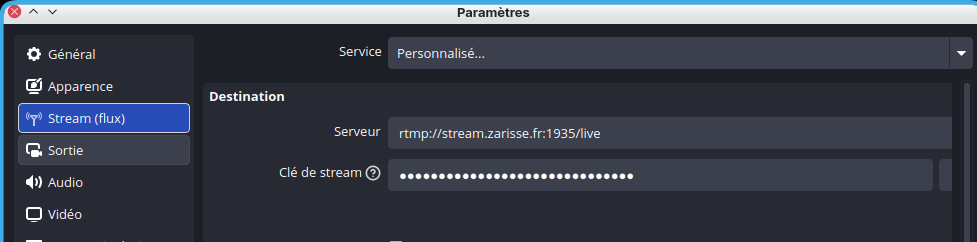
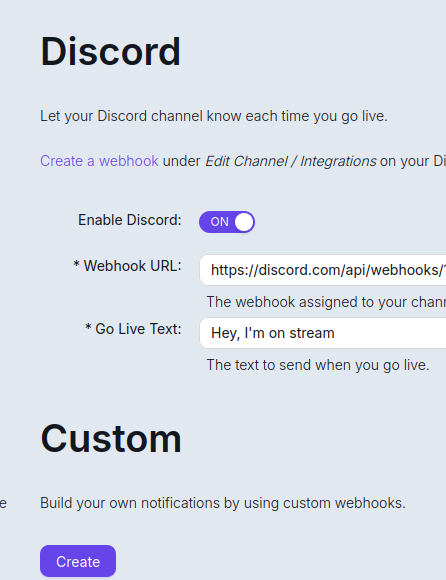

---
date:
  created: 2026-11-09
  updated: 2026-11-11 06:43
weight: -202611090000
---
# Logiciel Owncast

## Streaming & Fédiverse

Owncast permet de faire du streaming auto-hébergé, avec un accès au Fédiverse. Il gère très bien les webhooks Discord.

Côté dépendances, on télécharge un fichier binaire unique. Si on n'est pas trop regardant là-dessus, c'est tout à fait acceptable.

L'installation est très simple. Une fois celle-ci faite, on se connecte à l'interface d'administration, on change le mot de passe par défaut, et tout fonctionne.

Owncast accepte le flux RTMP directement sur le port 1935. Dans OBS, on renseigne le serveur `rtmp://mon-domaine:1935/live` et la clé de diffusion définie dans l'administration.

Côté OBS, c'est très simple aussi  L'interface web d'Owncast écoute par défaut sur le port 8080. nginx sert de reverse proxy HTTPS devant ce port, avec le certificat Let's Encrypt.

## NGINX : Configuration pour Debian 13

Le chat utilise des websockets. Il faut donc ajouter ce bloc dans la section `http` de `/etc/nginx/nginx.conf` :

```
map $http_upgrade $connection_upgrade {
    default upgrade;
    ''      close;
}
```

Puis le serveur HTTPS :

```
server {
    listen 443 ssl;
    server_name mon-domaine;

    ssl_certificate     /etc/letsencrypt/live/mon-domaine/fullchain.pem;
    ssl_certificate_key /etc/letsencrypt/live/mon-domaine/privkey.pem;

    location / {
        proxy_pass http://127.0.0.1:8080;
        proxy_set_header Host $host;
        proxy_set_header X-Forwarded-Host $host;
        proxy_set_header X-Forwarded-Proto $scheme;
        proxy_set_header X-Real-IP $remote_addr;
        proxy_set_header X-Forwarded-For $proxy_add_x_forwarded_for;
        proxy_set_header Upgrade $http_upgrade;
        proxy_set_header Connection $connection_upgrade;
        proxy_http_version 1.1;
    }
}
```

Le port 1935 doit être ouvert dans le pare-feu pour qu'OBS puisse se connecter. Le port 8080 ne doit pas être exposé directement.

## Fédiverse

Il n'est pas nécessaire d'avoir ses propres comptes renseignés. Owncast diffuse sur son propre réseau, déjà inclus dans le logiciel.

L'interface des différents réseaux sociaux est prévue. Rien à redire. 

Voilà, je pense avoir fait le tour de ce que je peux dire après ma première utilisation. À vous de l'essayer :)

[Owncast](https://owncast.online/)
