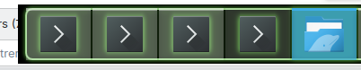
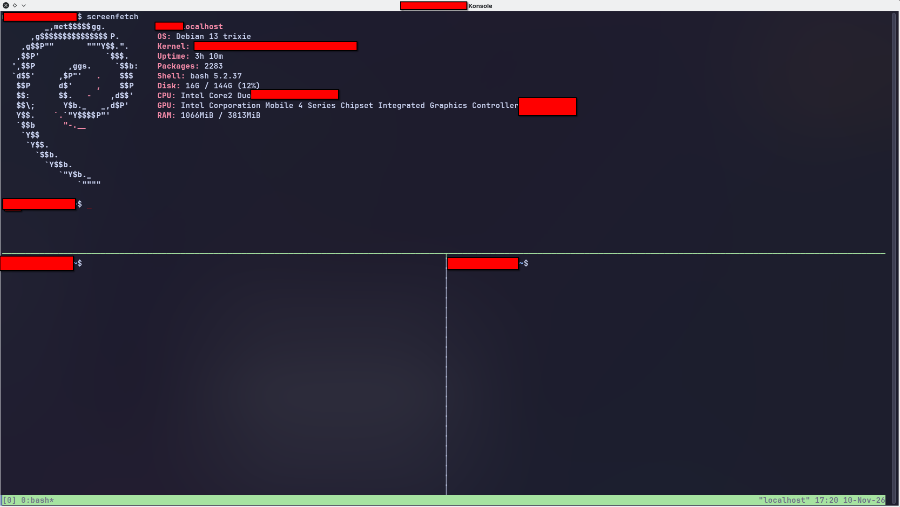

---
date:
  created: 2026-11-10 16:18
  updated: 2026-11-10 20:57
weight: -202611101618
---
# Le multiplexage

Quand on gère plusieurs choses (pas forcément), c'est utile d'avoir plusieurs terminaux ouverts.
Le multiplexage permet d'éviter cet « enfer » et de ne pas galérer à retrouver la bonne fenêtre selon ce que l'on veut faire.



## La solution

Le multiplexage. Ça va vous permettre d'avoir plusieurs terminaux dans un seul.
C'est pratique dans le cas d'un serveur distant, quand on est limité en nombre de connexions simultanées.

Il existe pas mal de logiciels de ce type. Je décide de me concentrer sur Tmux.

## Installation de Tmux

### Debian
Tmux est disponible dans les paquets par défaut.
```bash
sudo apt update
sudo apt install tmux --yes
```

### ArchLinux (BTW)

Pareil sur Arch, c'est disponible via pacman :
```bash
sudo pacman -S tmux
```

## Les arguments
```bash
# Diviser l'écran haut/bas
tmux split-window -v

# Diviser l'écran gauche/droite
tmux split-window -h
```
+ Plus d'arguments [ici](https://www.terminal.guide/tools/multiplexer/tmux/split-window-guide/)

## Les raccourcis clavier

- Diviser l’écran haut/bas :
    - Ctrl + b, relâchez, puis “

- Diviser l’écran gauche/droite : 

    - Ctrl + b, relâchez, puis %

- Changer de fenêtre (panneau) :
    - Ctrl + b, relâchez, puis utilisez les flèches directionnelles pour aller vers le panneau voulu




Plus de raccourcis et d'arguments [ici](https://tmuxcheatsheet.com/)