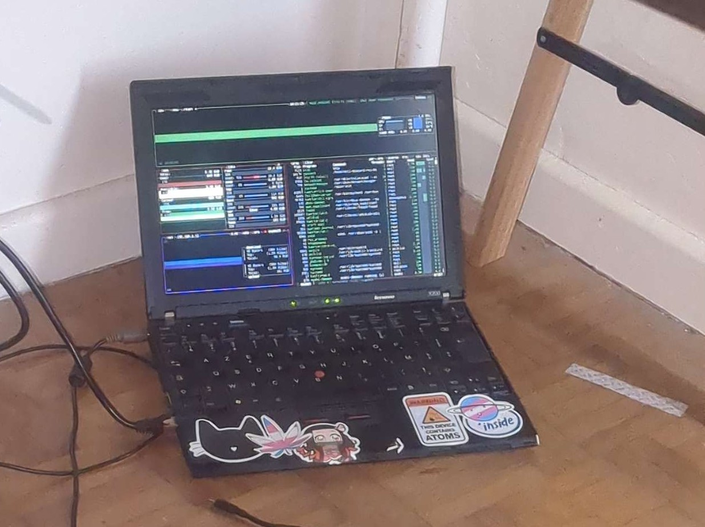

---
date:
  created: 2026-11-08
  updated: 2026-11-08
---
# La_stack

que j'utilise pour ce site :

- [Debian](https://www.debian.org/)
     - Avec les mises a jours activés, et auto [c'est mieux](https://jordanchapuy.com/posts/2026/11/mise-a-jour-automatique-debian/).
- [nginx](https://www.nginx.com/)
- [nginx-rtmp](https://www.nginx.com/resources/wiki/modules/rtmp/)
- [fail2ban](https://www.fail2ban.org/)
- [OpenSSH](https://www.openssh.org/)
- [Python](https://www.python.org/)
- [zensical et les plugins officiels](https://github.com/zensical/zensical)
- des scripts pythons pour me faciliter le deploiement en parallele avec vscodium

## Sur le serveur

tourne egalement :

- [tailscale](https://tailscale.com/), pour un projet partagé,
- [dnsmasq](https://dnsmasq.org/doc.html), pour la redirection vers mon IP

## Le serveur

Ce site tourne sur un [vieux lenovo](https://en.wikipedia.org/wiki/ThinkPad_X_series), qui tient encore,

