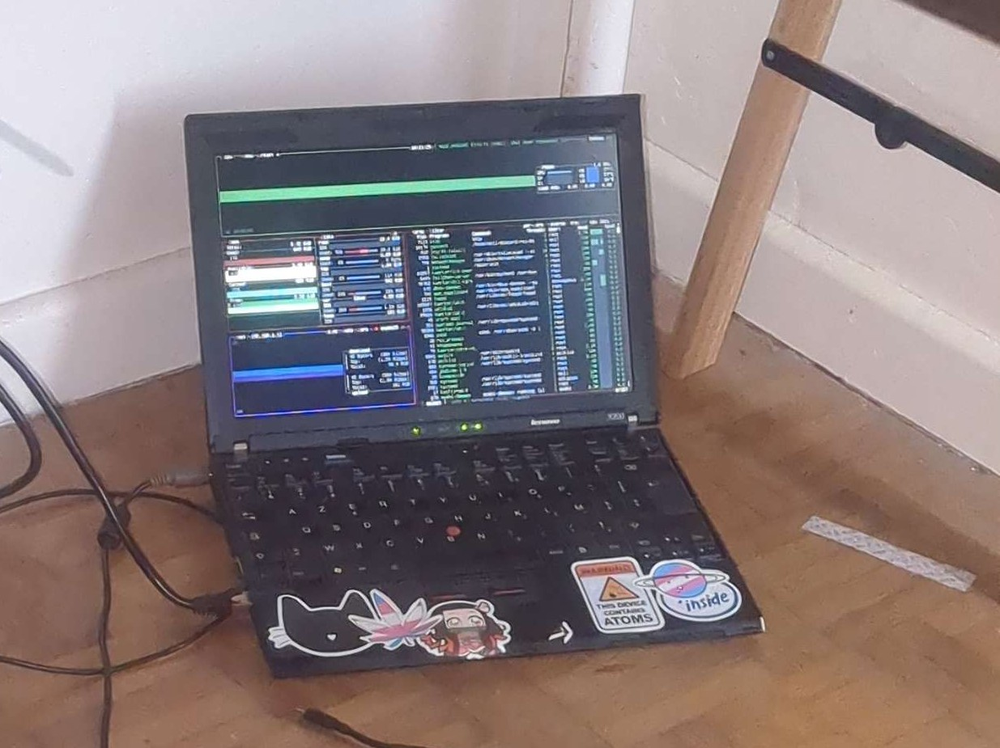

Logiciels libres, luttes sociales, anarchie, et ma vie de personne trans.

## AboutMe

- Un.e utilisateur.ice de logiciels libres
- Un.e trash trany
- Un.e vibecodeur.euse
- Un.e adminsys a la zob
- Un.e powerUser sur Linux
- Un.e psychiatrisé.e
- Tae Nemesis si tu es un.e faf

## Réseaux

- [GitHub](https://github.com/zarissa92)
- [Mastodon](https://tech.lgbt/@zarisse)

## Discord

- zarisse
- le discord officiel [Gauchiasses.fr](https://discord.gg/mfjHSwFKF)

## Contact

Tu peux aussi m'écrire par mail : [frisk-expose-croak@duck.com](mailto:frisk-expose-croak@duck.com)

## Autre site

- [Gauchiasses.fr](https://gauchiasses.fr)

## Le serveur

Ce site tourne sur un vieux lenovo, qui tient encore,

<!-- billets:debut -->
**Sections :**

- [Billets2Blog](Billets2Blog/index.md)
- [Divers](divers/index.md)
<!-- billets:fin -->
